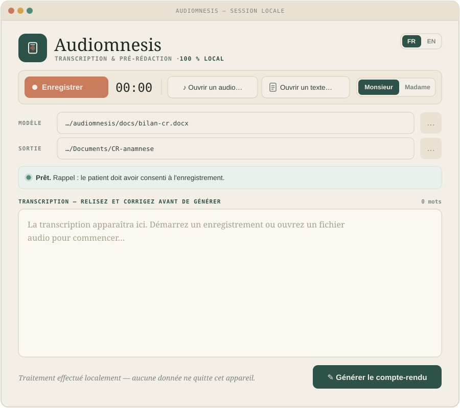

# Audiomnesis

<p align="center">
  
</p>

Outil 100 % local pour cliniciens — enregistrez l'entretien d'anamnèse, laissez
la machine le transcrire et pré-rédiger votre compte-rendu Word, sans qu'aucune
donnée ne quitte l'ordinateur. — *Fully local tool for clinicians: record the
anamnesis interview, get it transcribed and pre-drafted into your Word report,
with no data ever leaving the computer.*

**[Français](#français) · [English](#english)**

---

## Français

### Ce que fait l'application

1. **Trois entrées** : enregistrement direct (bouton ● Enregistrer, avec
   minuteur), fichier audio existant (`.m4a`, `.mp3`, `.wav`…), ou texte déjà
   écrit (fichier ou copier-coller).
2. **Transcription** locale en français par Whisper (`large-v3-turbo` via
   whisper.cpp) — vous relisez et corrigez le texte dans l'application.
3. **Pré-rédaction** des sections anamnestiques de votre modèle Word (plaintes,
   antécédents personnels et familiaux, développement, thymie/sommeil/appétit,
   introduction et champs administratifs) par un modèle de langage local
   (Ollama, `gemma3:4b`), dans un style clinique défini par des canevas.
4. **Sortie** : un dossier `CR_<date>/` contenant le `.docx` rempli (mise en
   page du modèle préservée, conclusions laissées vierges) et la transcription
   `.txt`.

L'interface est en français ou en anglais (bouton FR/EN) ; le compte-rendu
généré est toujours en français.

### Prérequis

- macOS (Apple Silicon), ≥ 8 Go de RAM, ~5 Go d'espace disque pour les modèles
- [Homebrew](https://brew.sh) · [Ollama](https://ollama.com/download) ·
  outils de développement Apple (`xcode-select --install`)

### Installation (une seule fois, avec Internet)

```bash
git clone https://github.com/GagGeo/audiomnesis.git
cd audiomnesis
./install.sh
```

`install.sh` installe ffmpeg et whisper.cpp, crée l'environnement Python,
télécharge les deux modèles (Whisper ~570 Mo, gemma3:4b ~3,3 Go), lance les
tests et construit `Audiomnesis.app`.

### Utilisation

1. Double-cliquez sur **`Audiomnesis.app`** (elle doit rester dans le dossier
   du projet ; glissez-la dans le Dock pour un accès rapide). Première
   ouverture d'une copie téléchargée : clic droit → Ouvrir (application non
   signée). Autorisez le micro et l'accès au dossier Documents quand macOS le
   demande. En cas de problème de lancement, consultez `.app.log`.
2. Vérifiez le modèle Word et le dossier de sortie ; choisissez
   Monsieur/Madame.
3. Enregistrez (consentement du patient requis), ou ouvrez un audio/texte.
4. Relisez et corrigez la transcription, puis **Générer le compte-rendu**.
5. **Relisez le brouillon** : c'est une aide à la rédaction, pas un
   compte-rendu final — les conclusions restent à rédiger par le clinicien.

### Adapter à votre pratique

- **Modèle de compte-rendu** : remplacez `docs/bilan-cr.docx` par le vôtre ;
  les ancres de sections sont définies dans `anamnese/sections.py`.
- **Style de rédaction** : encodé sous forme de canevas SANS aucun fait
  clinique dans `anamnese/prompts.py` (`STYLE_SKELETONS`). N'y mettez jamais
  un vrai compte-rendu : un petit modèle local recopie les faits d'un patient
  dans le rapport d'un autre.
- **Modèle de langage** : `anamnese/config.py` (`OLLAMA_MODEL`). Sur 8 Go de
  RAM, restez sur un modèle ~4b sans mode « thinking » (gel de la machine
  constaté avec les 8b ; fuite du raisonnement dans le texte avec qwen3).

### Confidentialité

- Transcription : whisper.cpp, processus local. Rédaction : Ollama sur
  `http://127.0.0.1:11434`. Fonctionne Wi-Fi coupé (test recommandé).
- Les enregistrements restent dans `recordings/` — supprimez-les
  régulièrement. Aucun fichier clinique ne doit être commité dans git.
- Consentement du patient requis pour l'enregistrement (RGPD).

---

## English

### What the app does

1. **Three inputs**: live recording (● Record button with a timer), an
   existing audio file (`.m4a`, `.mp3`, `.wav`…), or already-written text
   (file or paste).
2. **Transcription** runs locally with Whisper (`large-v3-turbo` via
   whisper.cpp) — you proofread and correct the text inside the app.
3. **Pre-drafting** of the anamnesis sections of your Word template
   (complaints, personal and family history, development, mood/sleep/appetite,
   introduction and administrative fields) by a local language model (Ollama,
   `gemma3:4b`), following clinical style skeletons.
4. **Output**: a `CR_<date>/` folder containing the filled `.docx` (template
   layout preserved, conclusions left blank) and the `.txt` transcript.

The interface is available in French and English (FR/EN switch); the generated
report is always French clinical prose.

### Requirements

- macOS (Apple Silicon), ≥ 8 GB RAM, ~5 GB of disk for the models
- [Homebrew](https://brew.sh) · [Ollama](https://ollama.com/download) ·
  Apple developer tools (`xcode-select --install`)

### Install (once, with Internet)

```bash
git clone https://github.com/GagGeo/audiomnesis.git
cd audiomnesis
./install.sh
```

`install.sh` installs ffmpeg and whisper.cpp, creates the Python environment,
downloads both models (Whisper ~570 MB, gemma3:4b ~3.3 GB), runs the tests and
builds `Audiomnesis.app`.

### Use

1. Double-click **`Audiomnesis.app`** (it must stay inside the project folder;
   drag it to the Dock for quick access). First launch of a downloaded copy:
   right-click → Open (unsigned app). Allow microphone and Documents-folder
   access when macOS asks. If launching fails, check `.app.log`.
2. Check the Word template and output folder; pick Mr/Ms.
3. Record (patient consent required), or open an audio/text file.
4. Proofread the transcript, then **Generate the report**.
5. **Proofread the draft**: it is a writing aid, not a final report — the
   clinical conclusions remain the clinician's to write.

### Adapting to your practice

- **Report template**: replace `docs/bilan-cr.docx` with your own; the section
  anchors live in `anamnese/sections.py`.
- **Writing style**: encoded as fact-free skeletons in `anamnese/prompts.py`
  (`STYLE_SKELETONS`). Never paste a real report in there: small local models
  copy one patient's facts into another patient's report.
- **Language model**: `anamnese/config.py` (`OLLAMA_MODEL`). With 8 GB of RAM,
  stay on a ~4b model without a "thinking" mode (8b-class models froze the
  machine; qwen3's reasoning leaked into the output).

### Privacy

- Transcription: whisper.cpp, local process. Drafting: Ollama at
  `http://127.0.0.1:11434`. Works with Wi-Fi off (recommended test).
- Recordings stay in `recordings/` — delete them regularly. No clinical file
  may ever be committed to git.
- Patient consent is required for recording (GDPR).
